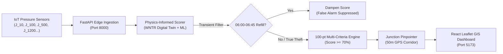

# NWSDB WaterGuard — AI-Driven Water Theft & Hydraulic Anomaly Pinpointing System
### Component 2: Network-Level Surveillance & Physical Chamber Pinpointing under Intermittent Water Supply (IWS)

[](https://www.python.org/downloads/)
[](https://fastapi.tiangolo.com)
[](https://react.dev)
[](https://leafletjs.com)
[](https://wntr.readthedocs.io)
[](https://docs.pytest.org)
[](LICENSE)

---

## 🌊 Overview

**NWSDB WaterGuard (Component 2)** is an end-to-end cyber-physical surveillance platform engineered for the **National Water Supply and Drainage Board (NWSDB), Western Production Division, Sri Lanka**. 

The system detects unauthorized commercial water bypasses, illegal suction pumps, and network anomalies within the **Kaduwela East Distribution Network (DMA 01 & DMA 02)**. It features a novel **physics-informed machine learning engine** that specifically solves the **false alarm crisis** caused by morning pipe-refill surges in **Intermittent Water Supply (IWS)** schemes.



---

## 🚀 Key Innovations & Features

- **Intermittent Refill Transient Filter**: Eliminates false alarms caused by empty pipe recharge surges between 06:00–06:45 AM using elapsed supply timers and acoustic validation.
- **4-Pillar Multi-Criteria Scorer**: Evaluates missing pressure head ($\Delta P \ge 2.0\text{m}$), spatial gradients across neighboring nodes, diurnal recurrence, and acoustic check state.
- **50-Meter Physical Inspection Corridor**: Automatically maps hydraulic residuals back to suspect junction coordinates (e.g. `J_100` at `[6.93541, 79.98425]`) with road access landmarks and direct Google Maps navigation links.
- **Key-Free GIS Surveillance Dashboard**: High-performance interactive map built with `react-leaflet` and public OpenStreetMap / CartoDB tiles—requiring **zero commercial API keys**.
- **Continuous Telemetry Streamer (`src/live_streamer.py`)**: Includes interactive CLI controls (`[n]` Normal, `[f]` Inject Bypass, `[r]` Refill Surge, `[a]` Automated Demo Cycle) transmitting packets every 2 seconds.
- **Automated One-Click Launchers**: Cross-platform startup and clean shutdown scripts for Windows ([`run_live_system.bat`](file:///c:/Users/kinara%20sadasi/OneDrive/Desktop/water_fraud_c2/run_live_system.bat)) and Linux/macOS ([`run_live_system.sh`](file:///c:/Users/kinara%20sadasi/OneDrive/Desktop/water_fraud_c2/run_live_system.sh)).

---

## ⚡ Quick Start

### Option 1: Automated Launcher (Recommended)

#### On Windows:
```cmd
run_live_system.bat
```

#### On Linux / macOS:
```bash
chmod +x run_live_system.sh
./run_live_system.sh
```
*This launches the FastAPI backend on port 8000, Vite frontend on port 5173, opens your default browser, starts the live telemetry streamer in automated demonstration mode, and cleanly terminates all sub-processes simultaneously when you press `Ctrl+C`.*

---

### Option 2: Manual Step-by-Step

#### 1. Setup Backend:
```bash
# Activate virtual environment
source venv/bin/activate  # On Windows: venv\Scripts\activate

# Install dependencies
pip install -r requirements.txt

# Start FastAPI server
uvicorn app.main:app --reload --port 8000
```

#### 2. Setup Frontend:
```bash
cd frontend
npm install
npm run dev
```
Open [http://localhost:5173](http://localhost:5173) in your browser.

#### 3. Start Live Telemetry Streamer:
```bash
# In automated demonstration cycle mode
python src/live_streamer.py --mode auto

# Or with interactive key controls ([n], [f], [r], [q])
python src/live_streamer.py --mode n
```

---

## 🧪 Testing & Validation

Run the complete 115-test test suite:
```bash
pytest
```
*All 115 unit, integration, and scenario tests execute in under 45 seconds.*

To run the full end-to-end system verification audit:
```bash
python verify_full_system.py
```

---

## 📁 Repository Structure

```text
water_fraud_c2/
├── app/                  # FastAPI backend routes, schemas, and middlewares
│   ├── main.py           # Core FastAPI application with CORS & no-cache headers
│   └── routes/           # Network status and telemetry endpoints
├── data/                 # EPANET .inp networks, GeoJSON boundaries, simulation datasets
│   ├── networks/         # Kaduwela 2-DMA clean East Side model
│   └── raw_simulations/  # Normal baseline, bypass injection, and leak scenarios
├── frontend/             # React 19 + TypeScript + TailwindCSS + Leaflet UI
│   ├── src/components/   # AdminAnomalyMap, StatCard, PressureChart
│   ├── src/pages/        # NetworkOverview, ZoneAnalysis, AlertsInvestigation
│   └── src/hooks/        # useLivePolling, useTelemetrySocket
├── models/               # Serialized ML models (Isolation Forest, Random Forest)
├── reports/              # Model evaluation metrics, charts, and viva presentation
├── scripts/              # Backup & restore, viva rehearsal, slide generator
├── src/                  # WNTR simulation, junction localizer, edge streamer
│   ├── live_streamer.py  # Continuous real-time telemetry streaming engine
│   ├── localizer.py      # Hydraulic sensitivity & chamber GPS pinpointer
│   └── scorer.py         # Multi-criteria fraud risk engine & IWS transient filter
├── tests/                # 115 Pytest unit and integration tests
├── run_live_system.bat   # Windows automated full-system launcher
├── run_live_system.sh    # Linux/macOS automated full-system launcher
├── RESEARCH_DEFENSE.md   # Comprehensive theoretical defense document
├── DEFENSE_FAQ.md        # Technical viva question & answer reference
└── SUBMISSION_INDEX.md   # Final academic and utility submission index
```

---

## 🏛️ Utility Partner & Research Context
- **Utility:** National Water Supply and Drainage Board (NWSDB), Sri Lanka
- **Operational Scheme:** Kaduwela Water Supply Scheme, Western Production Division
- **Network Scope:** 3,904 junctions, 4,279 pipes, 2 District Metered Areas (DMA 01: Industrial Corridor, DMA 02: Residential Control)
- **Academic Context:** Postgraduate MSc Research Defense in Cyber-Physical Water Infrastructure Security
